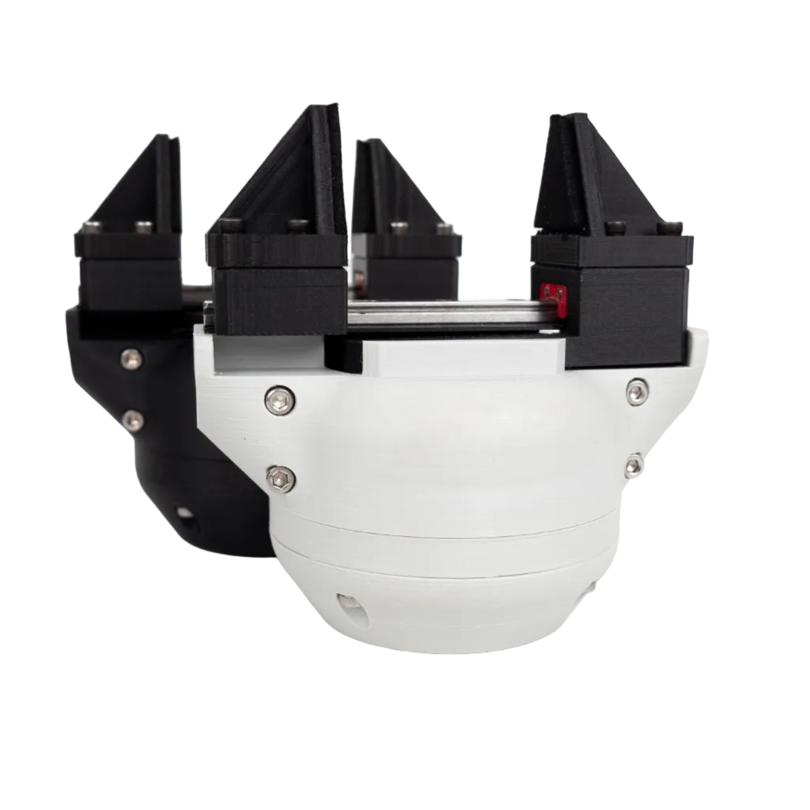

# Build your own

**The SSG-48 is open source, and that is important to us.** Everything the gripper is made of is published in the
[product repository](https://github.com/Source-Robotics/SSG-48-adaptive-electric-gripper) under the Apache 2.0
licence: the STEP files, the printable parts of both hardware versions, the bill of materials with a link for every
item, the assembly manual and video, the fin-ray and pinch fingers, and the URDF and MJCF models. The driver's
firmware and the software that drives the gripper are open source too. A gripper you build is the same gripper as
the one from the shop, and this manual applies to it; design your own fingers on the jaw plate template, or a
coupler connector for a robot the gripper was not designed for. This page is the order to do it in.

!!! warning
    A self-built gripper is yours to make safe: the thermistor in the windings, the current within what the motor
    stands, and the [Safety](../02-safety.md) chapter apply to it as to a bought one.

## 1. Print the parts

The [Gripper STL parts](https://github.com/Source-Robotics/SSG-48-adaptive-electric-gripper/tree/main/Gripper%20STL%20parts)
folder has the printable parts of both hardware versions; print the `V2` set (the large-bearing version, see
[Hardware versions](hardware-versions.md)), the two jaws, the guide cover, and the coupler connector for your
robot. PETG for the body; the fin-ray fingers in a flexible filament.

<figure markdown="span">
  { width="600" }
  <figcaption>Figure 2: The body printed in black and in grey, the two colours the shop sells.</figcaption>
</figure>

## 2. Source the rest

The [BOM](https://github.com/Source-Robotics/SSG-48-adaptive-electric-gripper/blob/main/BOM/BOM.md) lists every
part with a link: the GBM5208-75 gimbal motor, the Spectral Micro driver, the encoder magnet, the thermistor, the
MGN7 rail and two carriages, the shaft coupler, the M8 connector and the short cables that connect the driver
inside, the brass inserts and the screws. The motor's datasheet is in the
[Assembly manual](https://github.com/Source-Robotics/SSG-48-adaptive-electric-gripper/tree/main/Assembly%20manual)
folder.

## 3. The cable

An M8 4-pin cable to your robot or your supply and CAN adapter: [The cable](../04-installation/cable.md) has the
wiring diagrams and the warning about the two robots' cables.

## 4. Assemble, and calibrate on the way

Follow the [assembly manual](https://github.com/Source-Robotics/SSG-48-adaptive-electric-gripper/blob/main/Assembly%20manual/Gripper_assembly_manual.pdf)
or the [assembly video](https://www.youtube.com/watch?v=127zXHKuqIg). The motor is calibrated during the
assembly, not before it: once the motor and the driver are in the body, the wires soldered and the thermistor in
the windings, and before the linear guide with the jaws goes on (page 22 of the manual), connect the serial
adapter, calibrate the motor and set up gripper mode, as in
[Driver configuration](../05-setup/driver-configuration.md). The racks would block the calibration's turns, so
the order matters. Then the linear guide with the jaws, the lid and the coupler connector.

## 5. Calibrate the gripper, move

Power up, calibrate the gripper, activate it and move it at a low current, as in
[Calibrate, activate, move](../05-setup/first-moves.md). If the calibration does not find both end stops, the
mechanism is too stiff: loosen the rail, check the pinion's depth in the racks, grease.
