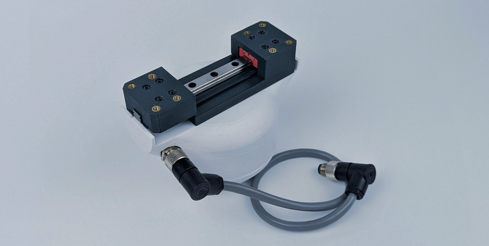

# The gripper at a glance

The SSG-48 is a two-jaw parallel gripper driven by a brushless gimbal motor under field-oriented control. The
[Spectral Micro driver](https://docs.source-robotics.com/Spectral-BLDC-docs/) inside the body regulates the
motor's current, so the gripper controls not only where its jaws are and how fast they move but how hard they
press: the current limit of a move is the grip force, adjustable from about 5 N to 80 N. The jaws stop on an
object and hold it with that force, and the driver reports that an object was found. That makes the gripper
gentle enough for soft objects, firm enough for tools, and safe to use around people.

<figure markdown="span">
  { width="900" }
  <figcaption>Figure 1: The SSG-48 gripper with its cable.</figcaption>
</figure>

## How it works

| Part | What it does |
|---|---|
| GBM5208-75 gimbal motor | the actuator: a brushless motor wound for high torque at low speed and low current |
| Spectral Micro driver, inside the body | field-oriented control of the motor, the gripper state machine, the CAN and UART interfaces |
| Pinion on the motor, two racks on a linear rail | the pinion turns, the two racks move in opposite directions: the jaws open and close symmetrically |
| MGN7 linear rail, 100 mm | carries the two jaw plates; 48 mm of stroke |
| Jaw plates | printed, with a four-hole pattern for your own fingers; fin-ray and pinch fingers in the repository |
| Thermistor in the motor windings | temperature protection: the gripper stops at 75 °C |
| M8 4-pin connector | 24 V and the CAN bus, one cable to the robot |
| Coupler connector | mounts the gripper on the PAROL6 or PAR6 wrist, on a UR5 flange, or on your own with the template |

The driver's status LED, its UART port and its CAN termination switch are inside the body, under the coupler
connector.

## What the firmware does

The gripper runs the Spectral firmware with its gripper mode turned on. After power-up it calibrates by finding
both end stops, then it accepts move commands: a jaw position from 0 (open) to 255 (closed), a speed from 0 to
255 and a current limit in mA. During a move the driver watches speed and current: when the jaws stop before the
target with the current at its limit, an object is in the way and the gripper holds it; when they reach the
target, it holds the position. The state the gripper reports with every answer says which: moving, object found
while closing, object found while opening, or at the position. [How the gripper works](../06-operation/how-it-works.md)
has the details.

The gripper protects itself: it stops on an over-temperature of the motor, on an E-stop bit from the host, on a
CAN watchdog that runs out, and on every fault the driver itself detects (supply voltage, encoder, driver stage).
[Errors and recovery](../06-operation/errors.md) says what each means.

## How it is controlled

- **CAN**, 1 Mbit/s, on the same cable as the power: one message moves the gripper and is answered with its
  state. From a PC with the CANvas adapter, from a ROS 2 node, from PAROL6 or PAR6, or from your own controller.
  See [Over CAN](../06-operation/can.md).
- **Python**, the `Spectral-BLDC` library on top of CAN. See [With Python](../06-operation/python.md).
- **Motor GUI** in the browser: connect, calibrate, open and close, watch the plots. See [Motor GUI](../05-setup/motor-gui.md).
- **UART**, the driver's serial port inside the body: for configuration, and for a self-built gripper. See
  [Over UART](../06-operation/uart.md).

## The MSG gripper

The [MSG gripper](https://docs.source-robotics.com/MSG-gripper-docs/) is the SSG-48's successor: the same
protocol and the same software, with a stepper motor and the STEPFOC driver instead of the gimbal motor, three
rail lengths and a camera mount. Programs written for one run on the other.
