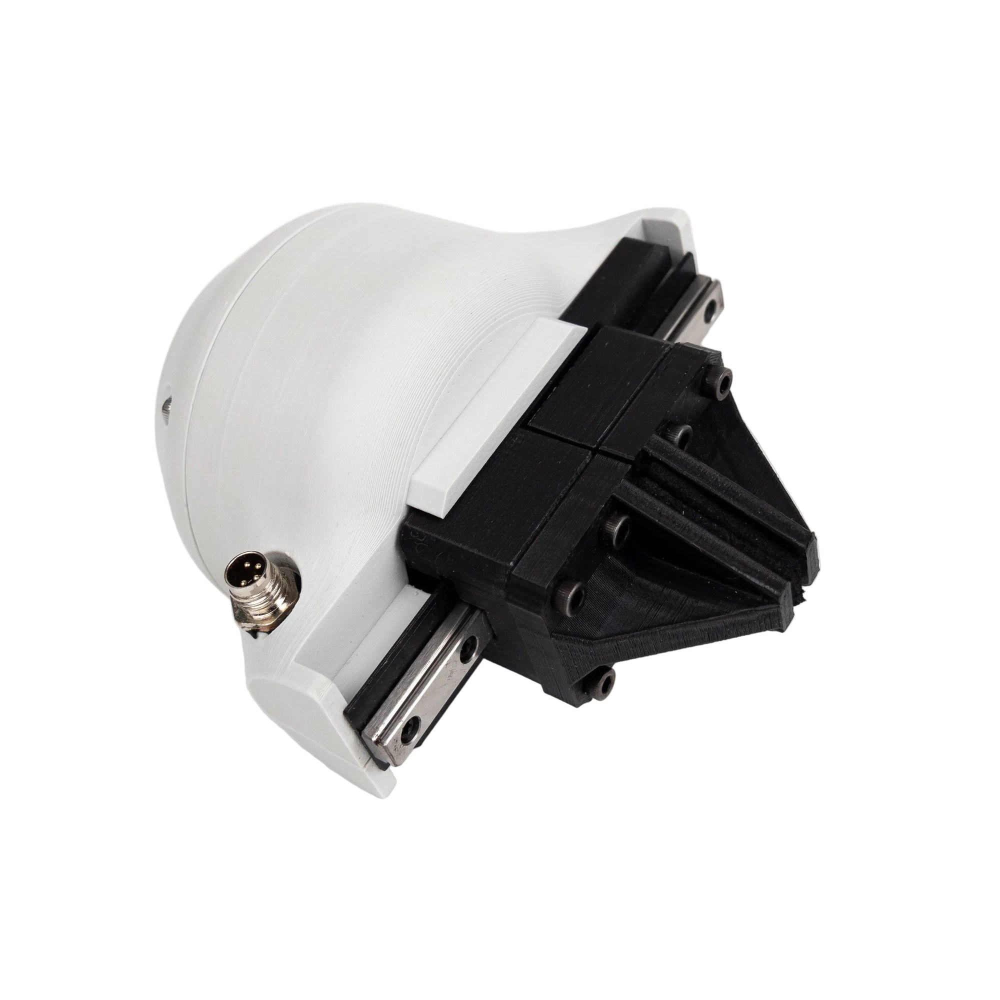

# The gripper at a glance

The SSG-48 is a two-jaw parallel gripper driven by a brushless gimbal motor under field-oriented control. The
[Spectral Micro driver](https://docs.source-robotics.com/Spectral-BLDC-docs/) inside the body regulates the
motor's current, so a move sets not only where the jaws go and how fast, but how hard they press: the current
limit is the grip force, from about 5 N to 80 N. The jaws stop on an object, hold it with that force, and the
driver reports that an object was found.

<figure markdown="span">
  { width="600" }
  <figcaption>Figure 1: The SSG-48 gripper with pinch fingers.</figcaption>
</figure>

## The parts

| Part | What it does |
|---|---|
| GBM5208-75 gimbal motor | the actuator: a brushless motor wound for high torque at low speed and low current |
| Spectral Micro driver, inside the body | field-oriented control of the motor, the gripper state machine, the CAN and UART interfaces |
| Pinion on the motor, two racks on a linear rail | the pinion turns, the two racks move in opposite directions: the jaws open and close symmetrically |
| MGN7 linear rail, 100 mm | carries the two jaw plates; 48 mm of stroke |
| Jaw plates | printed, with a four-hole pattern for your own fingers; fin-ray and pinch fingers in the repository |
| Thermistor in the motor windings | temperature protection: the gripper stops at 75 °C |
| M8 4-pin connector | 24 V and the CAN bus, one cable to the robot |
| Coupler connector | mounts the gripper on the PAROL6 or PAR6 wrist, on a UR5 flange, or on your own with the template |

The driver's status LED, its UART port and its CAN termination switch are inside the body, under the coupler
connector.

## What the firmware does

After power-up the gripper calibrates by finding both end stops. Then it takes move commands: a position from 0
(open) to 255 (closed), a speed from 0 to 255 and a current limit in mA. When the jaws stop short of the target
with the current at its limit, an object is in the way and is held; when they reach the target, the position is
held. Every answer carries the state: moving, object found while closing or opening, or at the position. The
gripper stops itself on an over-temperature, an E-stop bit from the host, a CAN watchdog that runs out, and every
fault the driver detects. [How the gripper works](../06-operation/how-it-works.md) and
[Errors and recovery](../06-operation/errors.md) have the details.

## How it is controlled

- **CAN**, 1 Mbit/s, on the same cable as the power: one message moves the gripper and is answered with its
  state. From a PC with the CANvas adapter, from a ROS 2 node, from PAROL6 or PAR6, or from your own controller.
  See [Over CAN](../06-operation/can.md).
- **Python**, the `Spectral-BLDC` library on top of CAN. See [With Python](../06-operation/python.md).
- **Motor GUI** in the browser: connect, calibrate, open and close, watch the plots. See [Motor GUI](../05-setup/motor-gui.md).
- **UART**, the driver's serial port inside the body: for configuration, and for a self-built gripper. See
  [Over UART](../06-operation/uart.md).

The [MSG gripper](https://docs.source-robotics.com/MSG-gripper-docs/) is the SSG-48's successor: the same
protocol and software, with a stepper and the STEPFOC driver, three rail lengths and a camera mount. Programs
written for one run on the other.
