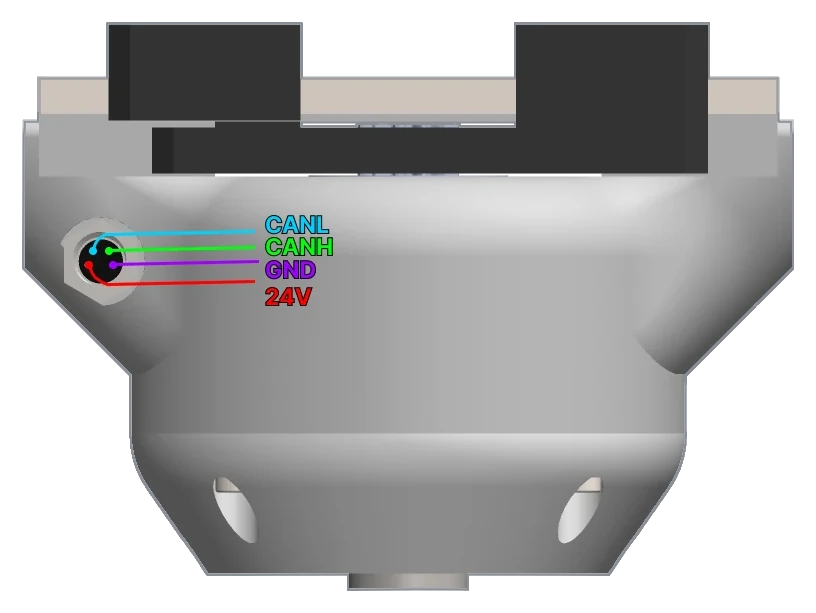
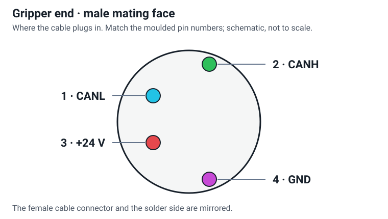

# Connector and pinout

The gripper has one connector, an M8 4-pin male on the side of the body, and one cable: 24 V and the CAN bus.

{ width="700" }

## Pin numbers

{ width="650" }

The drawing shows the connector's staggered contact layout. Look **into the male connector on
the gripper**, with its pins visible. The female cable connector has the
mirrored contact view. The solder side is also mirrored: use the numbers moulded into the connector, rather
than matching wire colours or the installed housing's rotation.

| Gripper pin | Signal | Connection |
|---|---|---|
| **1** | **+24 V** | positive motor supply |
| **2** | **CANL** | CAN low |
| **3** | **GND** | power-supply return |
| **4** | **CANH** | CAN high, 1 Mbit/s with CANL |

These are the pin numbers the gripper is built with, from page 17 of the
[assembly manual](https://github.com/Source-Robotics/SSG-48-adaptive-electric-gripper/blob/main/Assembly%20manual/Gripper_assembly_manual.pdf): the photo there
and the picture above show the same four signals.
They describe the **gripper end**. PAROL6 and PAR6 use different connections at the robot end:
[The cable](../04-installation/cable.md) gives both diagrams. Check continuity with the supply disconnected.

!!! danger "The wrong cable destroys the driver"
    A cable with 24 V on a CAN pin destroys the driver inside the gripper the moment it is powered. Use the cable
    made for your robot; check a self-made cable pin by pin against the pinout above and the wiring diagram before you
    plug it in.

## Inside the body

The Spectral Micro driver's own connectors are inside, reachable when the coupler connector is unscrewed: its
UART port (3.3 V, JST SH, 4 pins), used to configure a self-built gripper ([Over UART](../06-operation/uart.md)),
and its CAN termination switch ([CAN termination](../04-installation/can-termination.md)). The driver's pinout
is in the [Spectral Micro documentation](https://docs.source-robotics.com/Spectral-BLDC-docs/latest/03-technical-data/connectors/).
