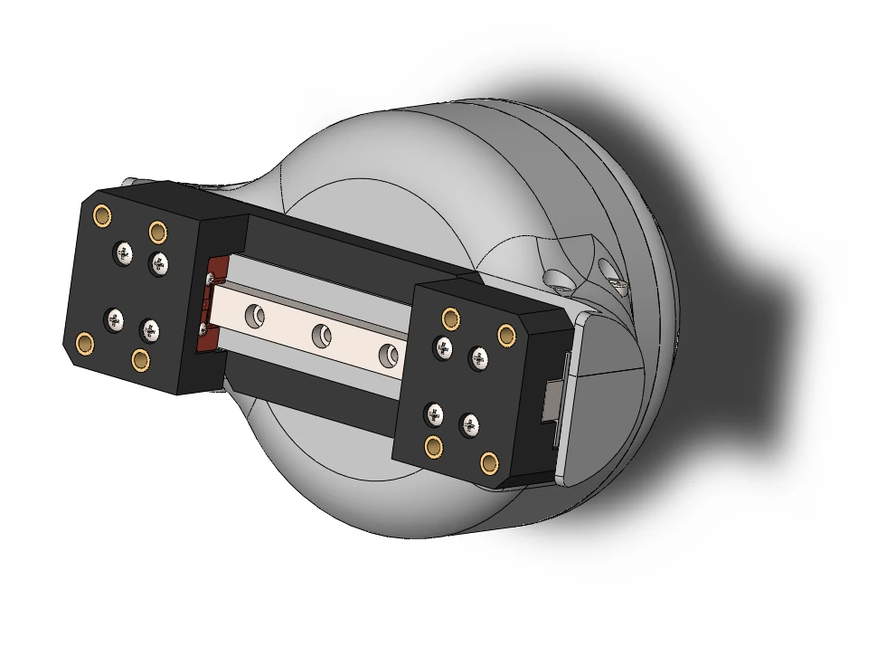

# Dimensions and CAD

  <canvas class="gripper-viewer__canvas" aria-label="The SSG-48 gripper in 3D: drag to turn, scroll to zoom"></canvas>
  

    <label class="gripper-viewer__field">Opening <input type="range" name="opening" min="0" max="100" value="50"></label>
    <label class="gripper-viewer__field">Fingers <select name="jaws"></select></label>
    <label class="gripper-viewer__field">Body <input type="color" name="body" value="#d2d2cf" title="Any colour"></label>
    <label class="gripper-viewer__field">Fingers colour <input type="color" name="jaws_color" value="#1a1a1a" title="Any colour"></label>
    <button type="button" name="reset" class="md-button">Reset view</button>
  

  
Drag to turn the gripper, scroll to zoom, open and close the jaws, try the fingers and the colours. The model is the
repository's <a href="https://github.com/Source-Robotics/SSG-48-adaptive-electric-gripper/tree/main/SSG48_gripper_description">URDF</a>, the fingers its printed options; the shop sells the body in black and grey.

<figure markdown="span">
  { width="700" }
  <figcaption>Figure 4: Front view, in millimetres: 104 mm over the jaw plates, 60.7 mm from the coupler face to the top of the jaw plates, 26 mm jaw plates.</figcaption>
</figure>

<figure markdown="span">
  { width="700" }
  <figcaption>Figure 5: Side view.</figcaption>
</figure>

<figure markdown="span">
  { width="600" }
  <figcaption>Figure 6: Top view, with the jaw plates and their hole pattern.</figcaption>
</figure>

<figure markdown="span">
  { width="700" }
  <figcaption>Figure 7: The gripper with the PAROL6 coupler connector.</figcaption>
</figure>

<figure markdown="span">
  { width="520" }
  <figcaption>Figure 8: 48 mm of stroke between the jaw plates, 104 mm overall.</figcaption>
</figure>

## CAD

The STEP files of every part are in the product repository, the reference for anything that has to fit:

- [STEPS](https://github.com/Source-Robotics/SSG-48-adaptive-electric-gripper/tree/main/STEPS): the body parts
  (`Gripper STEP files`), the whole gripper (`3D MODEL`), the jaw plate template, the pinch jaws, the generic
  coupler connector template and the UR5 adapter plate.
- [Gripper STL parts](https://github.com/Source-Robotics/SSG-48-adaptive-electric-gripper/tree/main/Gripper%20STL%20parts):
  the printable parts of both hardware versions and the coupler connectors for PAROL6 and PAR6.
- [gripper jaws](https://github.com/Source-Robotics/SSG-48-adaptive-electric-gripper/tree/main/gripper%20jaws):
  the fin-ray fingers and their jaw plate.

<figure markdown="span">
  { width="600" }
  <figcaption>Figure 9: The STEP model of the gripper.</figcaption>
</figure>

## For simulation

The [SSG48_gripper_description](https://github.com/Source-Robotics/SSG-48-adaptive-electric-gripper/tree/main/SSG48_gripper_description)
folder has a URDF of the gripper and an MJCF for MuJoCo 3.1.3 and newer, with a scene file.

[CAD and downloads](../cad-files.md) lists everything that can be downloaded.
