# Bill of materials

!!! note "This is a copy"
    The original is [BOM/BOM.md](https://github.com/Source-Robotics/SSG-48-adaptive-electric-gripper/blob/main/BOM/BOM.md) in the gripper's repository; this page is that file as of
    2026-10-31 (commit `c2976a1`), with the reference images shown inline. If a link is broken or a part is wrong,
    [open an issue](https://github.com/Source-Robotics/SSG-48-adaptive-electric-gripper/issues/new) there, and the fix lands here with the next sync. The shop's
    [starter kit](index.md#kits-and-the-shop) covers the driver and everything its setup needs.

This BOM lists all components required to build the SSG48 gripper. Quantities are for **one gripper**.

!!! note
    If any product links are broken, unavailable, or no longer point to the correct item, please [open an issue](https://github.com/Source-Robotics/SSG-48-adaptive-electric-gripper/issues/new), send us a message on Discord, or contact us via email. You can also use the reference images to find the same or an equivalent part from another supplier.

## Screws and Nuts

| Diameter / Type | Length | Quantity | Description | Link |
|-----------------|--------|----------|-------------|------|
| M2.5 | 8 mm | 4 |  |  |
| M2 | 4 mm | 8 |  |  |
| M3 | 5 mm | 5 | Cheese head screw |  |
| M2 | 10 mm | 1 |  |  |
| M3 | 8 mm | 7 | Cheese head screw |  |
| M4 | 10 mm | 4 |  |  |
| M3 | 12 mm | 4 |  |  |
| M3 | 10 mm | 4 |  |  |

## Brass Inserts

| Thread | Length | Outer Diameter | Quantity | Description | Link |
|--------|--------|----------------|----------|-------------|------|
| M3 | 3 mm | 4.5 mm | 1 | 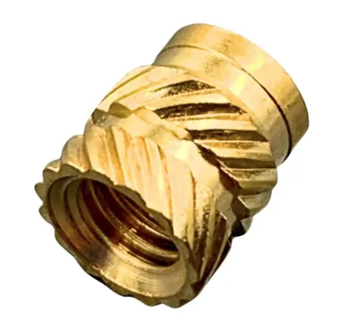{ width="120" } | [Link](https://s.click.aliexpress.com/e/_DnCPrW9) |
| M3 | 5 mm | 4.5 mm | 15 | { width="120" } | [Link](https://s.click.aliexpress.com/e/_DnCPrW9) |

## Motors

!!! note
    **If you are having a hard time sourcing motors consider building our [MSG gripper](https://github.com/Source-Robotics/MSG-compliant-AI-stepper-gripper)!**

| Type | Quantity | Description | Link |
|------|----------|-------------|------|
| GBM5208-75 | 1 | 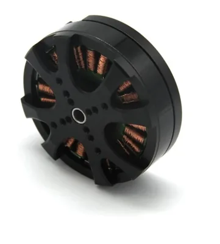{ width="120" } | [Link](https://s.click.aliexpress.com/e/_DmkWskt) //  [Alibaba link](https://www.alibaba.com/product-detail/Flashhobby-GBM5208-75-0-3KG-5208_1601005642241.html) |

## Mechanical Components

| Type | Quantity | Description | Link |
|------|----------|-------------|------|
| Shaft coupler | 1 | 8 mm hole shaft, M4 screw holes 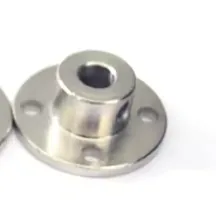{ width="120" } | [Link](https://www.aliexpress.com/item/4000208248034.html?spm=a2g0o.order_list.order_list_main.521.6af018026rwEsK) |
| MGN7C slider | 2 | 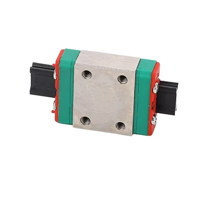{ width="120" } | [Link](https://s.click.aliexpress.com/e/_oEZfs3x) |
| Linear guide | 1 | 100 mm 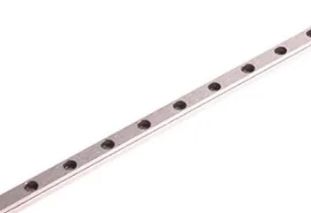{ width="120" } | [Link](https://s.click.aliexpress.com/e/_oBSDfjN) |
| Magnet | 1 | 6 mm diameter, 2.5 mm thickness, diametrically magnetised { width="120" } | [Link](https://source-robotics.com/products/6x2-5mm-diametrical-neodymium-magnet) |

## Electronics

| Type | Quantity | Description | Link |
|------|----------|-------------|------|
| Spectral micro BLDC driver | 1 | [source-robotics.com](http://source-robotics.com/) 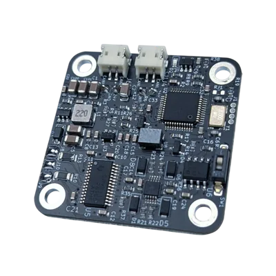{ width="120" } | [Link](https://source-robotics.com/products/spectral-micro-bldc-controller) |
| XH 2.54 mm, 300 mm, 2P, double-ended | 1 | Cable for 24 V 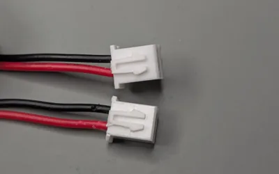{ width="120" } | [Link](https://s.click.aliexpress.com/e/_c4XKzTj9) |
| ZH 1.5 mm, 300 mm, 2P, double-ended | 1 | Cable for CAN bus 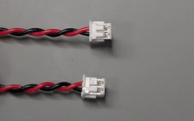{ width="120" } | [Link](https://s.click.aliexpress.com/e/_c4XKzTj9) |
| Male 4-pin connector | 1 | 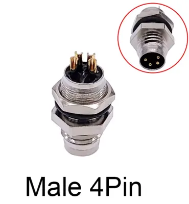{ width="120" } | [Link](https://s.click.aliexpress.com/e/_DCG5Rff) |

## Cables

Parts for the DIY cable version below:

| Type | Length / Spec | Quantity | Description | Link |
|------|---------------|----------|-------------|------|
| 26 AWG cable | 0.15 mm², 4-wire twisted pair | 0.4 m | Usually 35 cm cable is enough 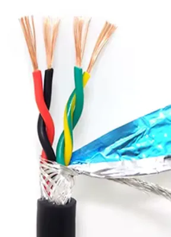{ width="120" } | [Link](https://s.click.aliexpress.com/e/_DeGUD4Z) |
| M8 4-pin male wire connector | — | 1 | 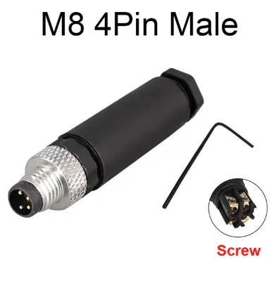{ width="120" } | [Link](https://s.click.aliexpress.com/e/_DCG5Rff) |
| M8 4-pin female wire connector | — | 1 | 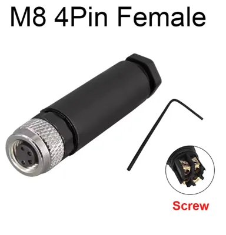{ width="120" } | [Link](https://s.click.aliexpress.com/e/_DCG5Rff) |

Check out the cable building guide [here](https://github.com/Source-Robotics/SSG-48-adaptive-electric-gripper/blob/main/Assembly%20manual/Building_cables.md)

!!! note
    Equivalent parts from other suppliers may be used as long as specifications match.
