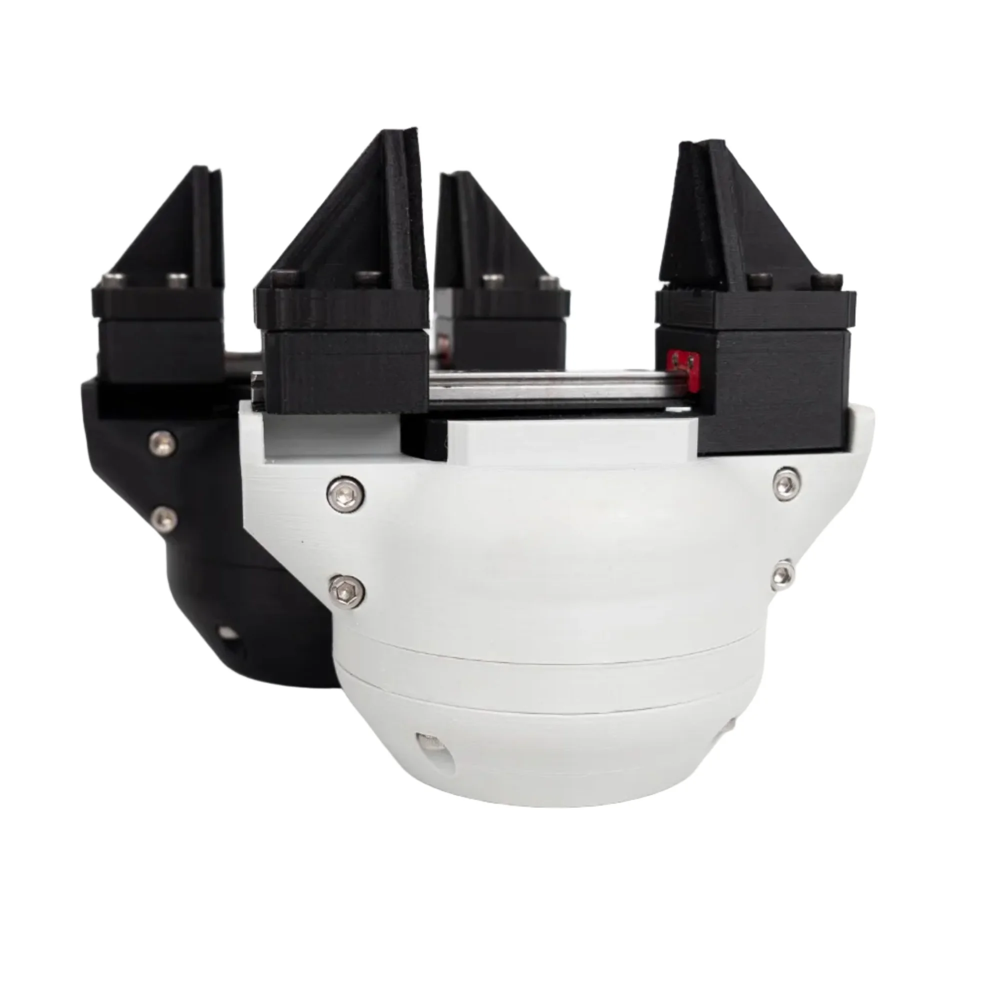

# Printing the parts

## Material and settings

PETG for the body, the lids, the jaw plates and the coupler connector; the fin-ray fingers in a flexible filament.
The assembly manual's reference prints were made on a Prusa MK2S in PETG with 25 % infill, supports only where a
part needs them: clean every support off before assembly, the bearing seats and the rail slot in particular.

<figure markdown="span">
  { width="600" }
  <figcaption>Figure 15: The body printed in black and in grey, the two colours the shop sells.</figcaption>
</figure>

## The files

| What | Where |
|---|---|
| The body, the lid, the gear and the magnet shaft, in two hardware versions: print the `V2` set, the large-bearing version ([Hardware versions](../01-overview/hardware-versions.md)) | [Gripper STL parts](https://github.com/Source-Robotics/SSG-48-adaptive-electric-gripper/tree/main/Gripper%20STL%20parts) |
| The jaws, the guide cover, and the coupler connectors for PAROL6 and PAR6 | the same folder |
| The fin-ray fingers and their jaw plate | [gripper jaws](https://github.com/Source-Robotics/SSG-48-adaptive-electric-gripper/tree/main/gripper%20jaws) |
| The STEP files, for a coupler connector of your own (the generic template) or your own fingers on the jaw plate | [STEPS](https://github.com/Source-Robotics/SSG-48-adaptive-electric-gripper/tree/main/STEPS) |

The brass inserts go in with a soldering iron after printing, as the assembly manual shows for each part.
