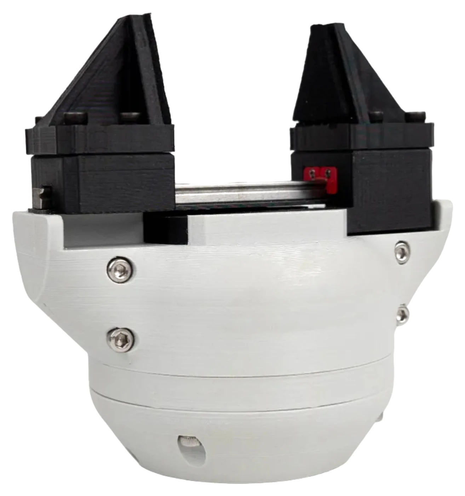

---
hide:
  - toc
comments: false
---

# SSG-48 Gripper Manual

{ .hero }

<!-- doc-meta: ssg48 -->

[Quick start](quick-start.md){ .md-button .md-button--primary } [About this manual](about.md){ .md-button }

Source Robotics d.o.o. publishes this document for the SSG-48 adaptive electric gripper. It is revised as the gripper and its
firmware change; the document number, the gripper release, the firmware, the revision and the date above identify
the version you are reading, and the document history on the About page says what changed. The version selector
in the header switches between gripper releases. The gripper runs the Spectral Micro driver's firmware: take care that
the firmware named under *Applies to* matches what the gripper reports. The text and the images are licensed
CC BY-SA 4.0, the code examples MIT.

**The SSG-48 is open source, and that is important to us.** Everything the gripper is made of is published: the
CAD and print files, the bill of materials, the assembly instructions, the driver's firmware and the software that
drives it. Buy the gripper assembled, or build one yourself; change the jaws or the body for your application and
fit it to any robot. The [build guide](build/index.md) is the order to do it in.

  <canvas class="gripper-viewer__canvas" aria-label="The SSG-48 gripper in 3D: drag to turn, scroll to zoom"></canvas>
  

    <label class="gripper-viewer__field">Opening <input type="range" name="opening" min="0" max="100" value="50"></label>
    <label class="gripper-viewer__field">Fingers <select name="jaws"></select></label>
    <label class="gripper-viewer__field">Body <input type="color" name="body" value="#d2d2cf" title="Any colour"></label>
    <label class="gripper-viewer__field">Fingers colour <input type="color" name="jaws_color" value="#1a1a1a" title="Any colour"></label>
    <button type="button" name="reset" class="md-button">Reset view</button>
  

  
Drag to turn the gripper, scroll to zoom, open and close the jaws, try the fingers and the colours. The model is the
repository's <a href="https://github.com/Source-Robotics/SSG-48-adaptive-electric-gripper/tree/main/SSG48_gripper_description">URDF</a>, the fingers its printed options; the shop sells the body in black and grey.

-   :material-play-circle:{ .lg .middle } **Quick start**

    ---

    [One-page quick start](quick-start.md): choose the cable, check the bus, connect Motor GUI, calibrate,
    and make the first gentle open and close. Each step says what to check before continuing.

-   :material-book-open-variant:{ .lg .middle } **The manual**

    ---

    [Safety](02-safety.md), [Technical data](03-technical-data/index.md), [Installation](04-installation/index.md),
    [First setup](05-setup/index.md), [Operation](06-operation/index.md), [Maintenance](07-maintenance.md), [Firmware](08-firmware.md),
    [Troubleshooting](09-troubleshooting.md).

-   :material-robot-industrial:{ .lg .middle } **On a robot**

    ---

    [PAROL6 and PAR6](06-operation/robots.md), [ROS 2](06-operation/ros2.md), [Python](06-operation/python.md):
    the gripper from the robot's own software, from a ROS 2 node, or from your program over CAN.

-   :material-code-braces:{ .lg .middle } **API reference**

    ---

    The gripper's [CAN messages](reference/can/index.md) and [UART commands](reference/uart/index.md), the
    [status bits](reference/errors.md) and the [Python library](reference/python.md), read from the firmware.

-   :material-hammer-wrench:{ .lg .middle } **Open source: build your own**

    ---

    [The build guide](build/index.md): the repository's bill of materials, printing, the assembly, the driver's
    setup and the first run. The same manual applies.

